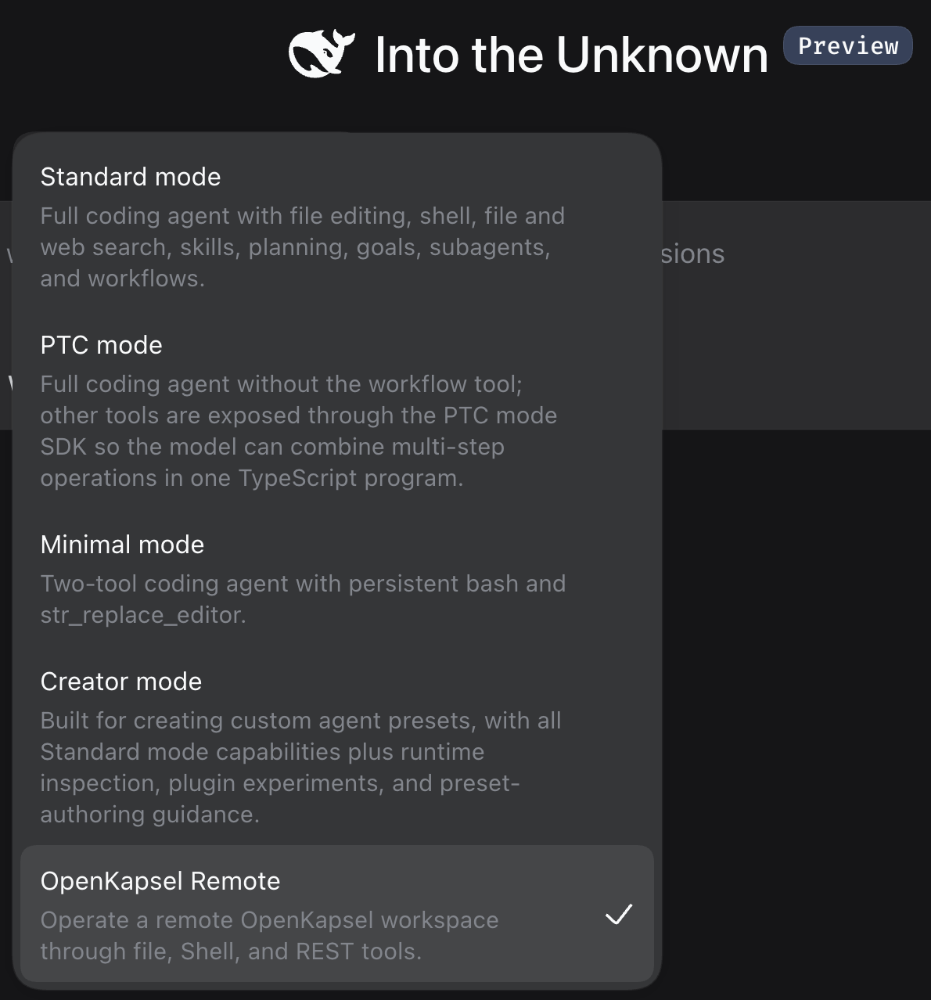

# dsh-openkapsel

[](https://github.com/zzzmmmnn/dsh-openkapsel/actions/workflows/tests.yml)
[](https://dsh-plugin.org/plugins/zzzmmmnn/dsh-openkapsel)

OpenKapsel workspace bridge for the **DeepSeek Harness**. It turns a remote
OpenKapsel workspace into model-visible tools: supply the read-only workspace
URL ending in `/w/<READ_TOKEN>` and its matching control token, and the agent
can list/read/write files, run Shell tasks, and call the other OpenKapsel REST
surfaces. The model has no host filesystem or host Shell tool in the bundled
remote-only preset.

The bridge reuses the workspace-published `openkapsel-rest` skill's Python
helpers (`openkapsel_http.py` and `openkapsel_config.py`), vendored under
`skill/`. Each `kapsel_*` tool invokes one of those two fixed scripts through
the harness host Shell service. The model cannot choose the script or use that
service as a Shell tool. Authentication, Context attribution
(`plan_id`/`taskname`/`message`), REST error decoding, and credential renewal
stay owned by the maintained skill code. Every helper subprocess receives an
explicit DSH `workspace-write` policy rooted at that agent's private state
directory; the executor also controls any platform temporary-directory access.

## Compatibility and permissions

| Area | Requirements and scope |
|---|---|
| DSH | Automatic mode registration requires DSH `0.2.0-rc.2` or newer with the declarative preset registry. Registration and tool activation are verified against `0.2.0-rc.2` and `0.2.1-rc.2` with the `web` profile. The legacy file installer is retained for older DSH versions. Other profiles are not verified. |
| Node.js | Package declares `>=18`; the test matrix covers Node.js 22 and 24. Use a version supported by your DSH installation; Node.js 18 is not covered by this project's CI. |
| Python | Python 3.10+ on the Host's `PATH`: `python` on Windows, `python3` on macOS/Linux. The test matrix covers 3.10 and 3.14. |
| Host platform | macOS/Linux use DSH's Bash executor; Windows uses DSH's PowerShell executor without Bash. GitHub installation and Host startup verified on macOS. Windows installation and actual plugin use confirmed by user testing (2026-09-09). Linux/Windows automated tests are configured in CI. |
| External service | Requires a reachable, user-selected OpenKapsel Server and its Workspace URL/control token. Requests and their supplied file contents or commands are sent to that server. |
| Local access | Runs fixed Python helpers through DSH's Shell service and writes session credentials under `$DSH_HOME/state/dsh-openkapsel` (default `~/.dsh/state/dsh-openkapsel`). Model-facing host file/Shell tools and `run_code` are denied. |
| Credentials | Stores the read URL and control token under the user's DSH state directory. Unix uses `0600` files and `0700` directories; Windows relies on the containing user directory's ACL (chmod does not enforce Unix permissions there). Automatic renewal may replace stored credentials. |
| Remote permissions | Can read, modify, and run Shell commands within the remote token's grants. Typed tools are conveniences; the server enforces authorization for generic REST calls too. |
| DSH policy | `read-only` denies remote mutations and Shell; a one-call approval may authorize a retry. `workspace-write` and `danger-full-access` both remain bounded by the remote token. |
| License | [MIT](LICENSE). This is a community plugin, not an official DeepSeek product. |

## Why the internal transport remains Python

An installed Cordis package could implement the transport in Node. This bridge
keeps Python because the existing helpers already own renewal, authentication,
error decoding, and Context merging. Reusing them avoids a second protocol
implementation that could drift as OpenKapsel evolves. This does not grant the
model a local Shell: script paths are plugin-owned constants and arguments
travel as JSON on stdin to a fixed Python bootstrap.

Requires `python` on Windows or `python3` on macOS/Linux on `PATH`.

## Layout

```text
index.js                Host-side Cordis plugin and typed remote tools
bundle.js               Legacy preset-copy bootstrap for pre-0.2 DSH
cordis.patch.yml        Declarative OpenKapsel mode registration
preset-install.js       Legacy, update-safe preset file installer
skill/openkapsel-rest/  Vendored REST skill and fixed Python helpers
preset/kapsel/          Canonical remote composition and legacy mode files
bin/install-preset.js   Copies mode files for older DSH installations
cordis.example.yml      Annotated bridge row
tests/                  Tool-catalog and remote-isolation tests
```

## Install

Install from GitHub into the DSH `web` profile:

```bash
dsh plugin --profile web add github:zzzmmmnn/dsh-openkapsel
```

No manual symlink or local source checkout is required. DSH manages the package
as a profile dependency. Its `dsh.bundle` patch declares **OpenKapsel Remote**
through `@deepseek-ai/dsh-agent-preset`. The bridge and its remote-only guard
belong to that mode; the default `standard` mode is unchanged.

Restart DSH after installing or updating. Create a new session and select
**OpenKapsel Remote**, then supply the workspace URL and matching control token
through `kapsel_config`. Existing non-empty sessions keep their selected mode.
The current DSH registry eagerly validates mode compositions, so tools can be
registered at startup while remaining visible only within the selected mode.

Version 0.9.5 fixes mode discovery on DSH 0.2. Copying files into
`$DSH_HOME/.agent-presets/kapsel` alone no longer registers a mode. No manual
profile patch or preset-copy command is needed with the new bundle. If you
previously added a `preset-openkapsel` declaration to your profile as a
workaround, remove that declaration when upgrading: the bundle now owns it.
Preserve any custom mode configuration by applying it as an override of the
bundle's `preset-openkapsel` row rather than adding a second declaration.

### Legacy DSH installations

For pre-0.2 installations that discover file-based presets, the explicit
`dsh-openkapsel-install-preset` command and `dsh-openkapsel/bundle` export remain
available. They copy to `$DSH_HOME/.agent-presets/kapsel` (default
`~/.dsh/.agent-presets/kapsel`) and preserve locally modified files. Use
`dsh plugin --profile web exec dsh-openkapsel-install-preset --force` only to
intentionally replace those files. Older hosts need their legacy profile
integration; the current automatic bundle targets the declarative registry.
Uninstalling the package does not delete legacy files or session credentials.

## Remote-only preset

Select **OpenKapsel Remote** in the DSH preset picker:



Do not add `dsh-openkapsel` to `standard` or `minimal`: both expose host-local
tools. The bundled preset intentionally omits host Bash/PowerShell,
filesystem/search/editor, job control, local `AGENTS.md` discovery, and local
skill discovery. It retains only the OpenKapsel bridge plus `skill`,
`ask_user_question`, and `todo_write`.

The plugin also installs a fail-closed tool guard. Accidentally composing an
undeclared or local tool therefore causes execution to be denied even if a
future preset edit makes that tool visible to the model. DSH's optional
`run_code` presentation transport is denied. Remote-only mode explicitly selects
native tools, so model-authored code is not executed through a host code runtime.

### DSH sandbox-mode mapping

The bridge resolves the current policy from `ctx.sandboxPolicy` for every tool
call:

| DSH mode | Remote OpenKapsel behavior |
|---|---|
| `read-only` | Allows configuration, status, Discovery, filesystem reads, and generic `GET`/`HEAD`; denies remote mutations and Shell execution |
| `workspace-write` | Allows every capability granted by the OpenKapsel token |
| `danger-full-access` | Same bridge behavior as `workspace-write`; it never widens the OpenKapsel token |

A denied mutation can be retried with a one-call approval request:

```json
{
  "sandbox_permissions": "workspace-write",
  "justification": "Update the requested remote configuration file once."
}
```

The plugin delegates the request to DSH's approval service before contacting
the remote mutation endpoint. Approval does not change the session's durable
sandbox mode. Rejection, cancellation, a missing approval channel, malformed
fields, and non-widening requests all fail closed.

The bridge row inside the bundled preset is:

```yaml
- id: tool-kapsel
  name: 'dsh-openkapsel'
  config:
    taskname: dsh
    enforceRemoteOnly: true
```

`dsh-openkapsel` consumes the host `shell`, `tools`, `skills`, and `sandboxPolicy` services and
publishes none. Mount it in the dedicated agent preset, not globally.

## Usage

1. `kapsel_config(workspace_url, control_token)` stores credentials in this
   DSH session's private plugin state, then selects or creates an active root
   Plan for mutation attribution. Re-run it to switch workspaces or rotate
   credentials.
2. `skill("openkapsel-rest")` loads the authoritative REST reference before
   nontrivial operations.
3. Operate through the remote tools:

| Tool | Purpose |
|---|---|
| `kapsel_config` / `kapsel_status` | Configure or inspect the active workspace |
| `kapsel_plan_update` | Update or complete a Plan (parentage cannot be changed) with a structured debrief with a structured debrief |
| `kapsel_fs_list` / `kapsel_fs_read_files` / `kapsel_fs_stat` / `kapsel_fs_grep` / `kapsel_fs_find` | Read-side filesystem |
| `kapsel_fs_write` / `kapsel_fs_replace` | Remote text write/edit |
| `kapsel_shell_exec` / `kapsel_task_output` | Run a Shell task on the server or a mapped client and poll its output |
| `kapsel_shell_request_approval`, `kapsel_files_request_approval`, `kapsel_function_request_approval` | Request legacy Shell/File or generic function-owned grants; return approval URLs without executing operations |
| `kapsel_mapping_list` | List mapped client directories, online status, and advertised execution/RPC capabilities |
| `kapsel_rpc` | Unified server/mapping RPC entry: omit `mapping_id` for the server workspace or provide it for a client mapping; sync returns directly, task returns a normal server or unified client task id; writes use DSH approval + Plan/Context and mapped writes require a writable mapping |
| `kapsel_fs_copy` / `kapsel_fs_move` / `kapsel_transfer` | Copy or move across workspace and client storage, then inspect/cancel/resume asynchronous transfers |
| `kapsel_recycle` | List, restore, or explicitly purge an item in the selected storage root |
| `kapsel_http` | Context, Memory, preview, schedules, and other REST surfaces |

For client mappings, first call `kapsel_mapping_list` and inspect the client's reported platform and sandbox mode. Shell execution uses `kapsel_shell_exec`; a mapped `cwd` with `target: "auto"` runs on that client and returns a unified task ID. Inspect output with `kapsel_task_output`, and use `kapsel_http` with the ordinary `/task/*` lifecycle for status, stdin, interrupt, or kill. Mapping-specific public task/argv REST endpoints are not exposed. An unsandboxed client task has that client's OS-account permissions.

`kapsel_shell_exec` accepts `target: "auto"` (default), `"server"`, or
`"client"`. Auto selects a connected client when `cwd` is inside its mapping
(for example `laptop/project`), otherwise the server. A missing/denied client
fails without server fallback. The client needs OpenKapsel 1.62.0+ and an
enabled writable execution mapping. Its own OS, sandbox, and limits apply;
server `/env` settings are not injected. The returned task ID works with
`kapsel_task_output` and the standard `/task/*` controls via `kapsel_http`.
Client stdout/stderr are combined in stdout; client stdin chunks are at most
16 KiB. The public execution interface is command-string based; there is no
mapping-specific literal-argv REST endpoint.

`kapsel_http.json` is always a JSON object. Endpoint fields belong inside it,
not beside it. Context-management endpoints are handled specially because
their `plan_id` fields describe the Context graph rather than ordinary
operation attribution; prefer `kapsel_plan_update` for Plan changes.

Each DSH agent is keyed separately by `agent.id`. Credentials live under
`$DSH_HOME/state/dsh-openkapsel/<sha256(agent.id)>/.openkapsel.env`; active Plan and
taskname values are held in an agent-keyed `WeakMap`. The local project cwd is
not used for credentials or remote-workspace selection. An absolute `stateDir`
plugin option can replace the default private state root.

For a recorded mutation, `taskname` is resolved from the current tool call,
then the selected active Plan/session value, then the value set by
`kapsel_config`, then the plugin's preset configuration, and finally `dsh`.
Empty and whitespace-only values do not suppress this fallback. The active
Plan is selected automatically when `plan_id` is omitted; selecting a
persisted Plan after a Host restart also restores that Plan's taskname. A
missing or blank `message` receives a short default operation message.

## Security notes

Typed tools are convenience wrappers, not an additional permission boundary.
`kapsel_http` exposes the REST surfaces available to the selected credential;
the remote server enforces endpoint, path, and capability authorization. DSH
read-only mode additionally denies mutating HTTP methods and Shell execution.
This assumes that GET/HEAD endpoints honor read semantics; project application
routes implement their own behavior and authorization.

The current DSH Shell service accepts a command string, not an argv array.
The bridge sends helper paths and arguments as ASCII JSON on stdin to a fixed
Python bootstrap. Model input never enters the Host Shell command text. NUL
arguments are rejected. Generated tests round-trip quotes, newlines,
substitutions, backslashes, empty strings, and Unicode through Bash on Unix and
PowerShell 7/Windows PowerShell 5.1 on Windows. Helpers retain their DSH sandbox
policy, and their exit codes propagate through PowerShell.

Version 0.5.0 renames the package, installer command, and default state directory
to `dsh-openkapsel`. Reinstall the preset and initialize credentials again after
upgrading. To reuse an existing private state directory, explicitly configure
`stateDir` to that directory. Tool names (`kapsel_*`) and the `kapsel` preset ID
remain stable.

## Development checks

Run `npm ci` and `npm test`. GitHub Actions checks Node.js 22/24 with Python
3.10/3.14 on Linux and Windows, including helper argument round-trip and remote
permission tests.

To check automatic mode registration against an installed DSH 0.2 host, set
`DSH_RUNTIME_PACKAGE` to that installation's `package.json` and run
`node --test tests/runtime.test.js`. For example, on macOS/Linux:

```bash
DSH_RUNTIME_PACKAGE="$(npm root -g)/@deepseek-ai/dsh/package.json" node --test tests/runtime.test.js
```

The test uses a fresh temporary profile, the host's real plugin loader and
Shell executor, and a local mock workspace. It checks mode discovery,
isolation from Standard mode, successful `kapsel_config` initialization,
Python error propagation, and a subsequent file listing. No model or external
OpenKapsel workspace is contacted.

Version 0.9.6 uses the DSH 0.2 Shell process-handle API
(`execute(spec)` followed by `result()`) for both Python helpers. The legacy
`run(spec)` API remains supported for older explicit integrations.

## Operational notes

- The control token is stored only in the session-private credential file with
  Unix mode `0600` (Windows uses inherited directory ACLs). Neither the token nor its host-private path is returned in tool
  results.
- The read token in the workspace URL is read-only; the control token unlocks
  writes, Shell, Context, and Memory.
- Every mutation is attributed to an active Plan with a `taskname` and
  `message`.
- Tokens go only to the workspace origin or documented transfer paths, never to
  preview or public-share URLs.
- The model-facing guard permits only `kapsel_*`, `skill`,
  `ask_user_question`, and `todo_write`.

## Verification

```bash
npm test
```

The tests assert that the bundled preset contains no local Shell/filesystem
provider and run two simulated DSH agents against separate HTTP workspaces. The
integration test verifies that each remote workspace receives only its own
write, the local sentinel remains unchanged, and credentials exist only under
the private state root.

## Temporary Shell and File approvals (OpenKapsel 2.3.0)

OpenKapsel uses explicit, scoped Workspace Password approvals independently
of the host agent's own mutation permission. Before unsandboxed Shell execution,
call `kapsel_shell_request_approval` with `target: "server"` or the exact
Mapping ID and a specific `reason`. The response may include an
`approval_url`; open it to grant access, then pass `approved: true` to
`kapsel_shell_exec`. The adapter supplies the owning Conversation's
`writer_nonce` automatically. Merely calling Shell never creates an
approval URL. An omitted Shell timeout defaults to 120 seconds; explicitly
provided finite positive timeouts are not capped by the old client maximum.

For generic function-owned Approval use `kapsel_function_request_approval` with
a registered `function`, exact `target`, function-specific `args`, and `reason`.
The adapter supplies the private Conversation writer nonce and owning Plan; the
returned approval URL does not execute the function. Approval never bypasses
explicit sandbox read-only or deny path rules. Completed Plans are immutable;
create a new Plan for later work while modifying existing Memory independently.

For File read/write grants, use `kapsel_files_request_approval` with
`access: "read"|"write"`, explicit `target`, `reason`, and optionally an
absolute external `path` (set `scope_is_directory: false` for a file alias).
After approval, call the relevant File REST API through `kapsel_http` with
`approved: true` and matching `target`. The adapter supplies the nonce and
Plan Context automatically, including for approved reads. File read and write
grants are separate; unscoped grants cannot unlock external paths. Grants
do not bypass path deny rules, Mapping write protection, OS permissions or
protected configuration. For more detail, read the bundled `shell` and `files`
reference chapters. Host agent write approval still applies to any request
needing remote mutation attribution.

`kapsel_fs_find` exposes indexed filename search with recursive fallback.
`query` is optional (omitting it matches all filenames), `mode` can be
`literal` or `glob`, and results can be sorted by name, path, size or
modification time. Use an explicit Mapping/Storage path to search that source.

## Unified RPC and read-side tools

Version 0.9.0 added `kapsel_fs_read_files`, `kapsel_fs_manifest`, and
`kapsel_fs_grep`. The current unified RPC contract targets OpenKapsel 1.62.0+.
Git and Archive operations use `kapsel_rpc`; Git read operations
remain independent of Shell/client execution permission and run bounded, validated Git reads directly in the original repository while retaining trusted operator Git configuration. Git `add`, `commit`, `restore`, `checkout`, branch/tag/stash mutations,
`fetch`, `pull`, `push`, and `clone` are `write=true, execution=task`;
Archive `create` and `extract` use the same task model.

`kapsel_rpc` is the single dynamic RPC entry point for both locations. Omit
`mapping_id` to target the server workspace; provide a mapping name to target a
client mapping. Server-capable families are advertised by Discovery under
`capabilities.mappings.rpc.families` with `server_rpc` and operation
categories such as `sync_reads` / `task_writes`. Client mappings continue to
publish per-operation `description`, JSON `input_schema`, boolean `write`,
and `execution` through `kapsel_mapping_list`.

A server task returns a normal server task id; a mapping task returns a unified
`client.<mapping>.<task>` id. Poll either with `kapsel_task_output`; inspect or
control either kind through ordinary `/task/*` routes with `kapsel_http`.
Never replay an uncertain write-task start. `write=true` always uses DSH
approval plus OpenKapsel Plan/Context; mapped writes additionally require the
mapping to be administratively writable. There is no server/mapping/FUSE
fallback after the RPC target is selected. Git reads/writes and Archive
list/read/create/extract all use `kapsel_rpc`.

The generic HTTP tool recognizes POST `fs/read/files` and `fs/query/manifest` as
read-only. It also classifies both `rpc/<family>/<operation>` and
`mapping/<mapping-name>/rpc/<family>/<operation>` from runtime RPC metadata, so
RPC reads bypass mutation approval while writes use approval and Plan
attribution. Archive preview uses generic `archive` RPC (`list`/`read`).
Other POST operations retain their existing guard. Query values may be arrays
to send repeated parameters, e.g. `include: ["*.py", "*.js"]` or
`file: ["a", "b"]`. The vendored REST skill is synchronized with the main
OpenKapsel project. Server RPC task deadlines default to 600 seconds unless
overridden (maximum 86400); mapped RPC task deadlines also obey the client task
policy. The bundled HTTP helper waits 120 seconds and the DSH helper process
budget is 130 seconds for ordinary synchronous requests.

## Client reconnects and portable text

The bundled REST references track OpenKapsel 2.3.0. The current mapping
handshake requires client 1.62.0+.

An interrupted connection does not automatically cancel a client Shell task.
Short tasks (timeout at most 120 seconds) run in the Client process and do not
survive a Client process restart. Longer tasks (timeout above 120 seconds) run in
the Client's shared, disk-backed Job Manager and can survive Client restart.
The Job Manager is limited to 16 jobs globally and four per Mapping key. Job IDs
have the form `&xxxx&`. Query `/task/*` after reconnect using the original ID;
Manager output is disk-backed and can be read incrementally. If a task has
disappeared, do not infer its outcome or automatically replay its start.
The Client default timeout is 120 seconds, while an explicit finite positive
timeout can be much longer (subject to the actual runtime policy).

Text APIs default to UTF-8 without using the host locale. For a non-default
encoding, pass `encoding` to `kapsel_fs_read_files` (or in the JSON body for
POST `fs/read/files`) and on each relevant item in POST `fs/write/mutate`. `kapsel_fs_write`
uses `file.create` or exact-ETag `file.replace`; `kapsel_fs_replace` requires the
exact `expected_etag` and an exact match count (default 1).

Supported codecs include UTF-8/BOM, explicit-endian UTF-16, Big5, GBK/GB18030,
Windows-1252, Latin-1, ASCII, and Shift-JIS. See the bundled files reference for
exact codec names and BOM rules. There is no guessing or lossy conversion.
LF, CRLF, and CR remain literal: exact replacements must match original endings,
and new text chooses its own endings. UTF-8-only byte cursors and search retain
their existing restrictions.

## RPC-first mappings (OpenKapsel 1.61.0+)

`kapsel_mapping_list` may report `online: true` and `mounted: false`: this is normal.
Use file, search, copy/transfer, archive and RPC tools directly; never mount a
mapping or run a Shell command just to make those interfaces work. Static preview
also uses RPC. Keep the default `target: "auto"`: a mapped cwd executes on its
client without a server mount; other working directories execute on the server.

For intentional server execution, the cwd mapping is automatic. Declare other
native filesystem dependencies with the optional `mount_mappings` array of at
most 256 non-empty workspace mapping names or IDs:

```json
{
  "command": "python laptop/project/main.py",
  "cwd": ".",
  "target": "server",
  "mount_mappings": ["laptop"]
}
```

Pass this to `kapsel_shell_exec`, or put it in `kapsel_http.json` for POST
`shell/exec`. The field does not change auto placement, and non-empty dependencies
are invalid for client execution. Both routes retain normal write approval and
Plan/Context attribution. Do not parse commands to guess dependencies or default
to mounting every mapping.

FastAPI's extra native dependencies belong in the application's
`api/mappings.json`, for example `{"mount_mappings":["datasets"]}`. Its containing
mapping is automatic. Mount leases follow the task or API worker, not one HTTP
request; ordinary file operations never use FUSE fallback. A server may disable
native mounts while leaving file/RPC and client execution available.

Current clients always enable core file RPC: **rpc.file has been removed**;
remove that key from older client configurations. Upgrade both client and server
for `file_stream` metadata. Treat `unavailable_mappings`, `truncated`, and
unavailable tree/manifest nodes as incomplete results, not missing files. After
a timeout, cancellation or lost write/start response, inspect existing tasks and
affected paths; never automatically replay the command or RPC mutation.

The bundled skill's mappings, Shell and web/application references document the
contract. Runtime Discovery remains authoritative for server-version differences.

### Shell startup request timeout

The plugin setting `shellRequestTimeoutSeconds` controls the HTTP wait for the
initial Shell-start response, including lazy native-mount setup. It defaults to
120 seconds and accepts finite numbers from 1 to 3600. Configure it in the DSH
composition row, not in the tool's request JSON:

```yaml
- id: tool-kapsel
  name: 'dsh-openkapsel'
  config:
    taskname: dsh
    enforceRemoteOnly: true
    shellRequestTimeoutSeconds: 300
```

Both `kapsel_shell_exec` and generic POST `shell/exec` calls use this setting.
The Python HTTP request uses that timeout; the host helper watchdog adds 10
seconds (130 seconds by default). Credential discovery/renewal and harness or
reverse-proxy limits may impose their own bounds; this is not a guarantee that
every setup completes within the configured time. Other endpoint budgets are
unchanged. A tool's `timeout_seconds` is the remote task execution deadline and
is deliberately independent. A failed startup request is never automatically
retried; its error reminds the model that timeout/cancellation does not prove the
remote task stopped and that `/task/*` must be inspected before any retry.

## Structured configuration and large tables

Use `kapsel_mapping_list` to inspect the client's `structured` and `tabular` schemas,
then call `kapsel_rpc`. Structured JSON/YAML/TOML edits use conditional atomic
write/patch tasks; CSV/Excel operations are read-only, including asynchronous
`tabular.scan`. CSV pages use authenticated seek cursors, not repeated row-offset
scans. Segment scans return explicit progress/continuation and must not be
mistaken for complete whole-file aggregates. Format availability depends on
optional libraries installed on the mapping client. No FUSE is needed.

The bundled `openkapsel-rest` skill includes `references/data-rpc.md`.

## SSH RPC

Use `kapsel_mapping_list` to inspect the client's `ssh` capability, then call
`kapsel_rpc`. SSH profiles and credentials stay on the mapping client. The
first operation may select a configured profile and returns a process-scoped
`connection_id`; later `exec`, SFTP read/list/stat, upload, and download
operations can reuse the same authenticated transport. Connections expire after
60 seconds idle by default, but active commands or transfers do not count as
idle. Expired, lost, and explicitly closed IDs fail distinctly and are never
silently reconnected.

All SSH operations advertise `write=true`, including remote reads, because
using client-local SSH credentials is privileged external access. They therefore
require DSH write approval, OpenKapsel Plan/Context, and an administratively
writable mapping. Never automatically replay `ssh_execution_uncertain` after a
transport loss. Paramiko is required only on the mapping client, not by this DSH
plugin.

The bundled `openkapsel-rest` skill includes `references/ssh-rpc.md`.

## Conversation and Plan updates (OpenKapsel 2.1.0)

The DSH bridge creates a Conversation when needed for automatic Plan management. It obtains `next_conversation_id`, creates a Conversation with an idempotent `request_id`, and retains its returned `writer_nonce` for non-cancellation Plan updates. Plan creation and updates append an AI context entry. Plan updates require the current positive `expected_revision`; fetch the Plan first to avoid stale updates. A Plan's parent cannot be changed after creation. Closed Plans cannot own ordinary new mutations. Error responses include a Unix-seconds server `timestamp`; see the transport reference for clockless clients and HTTP 200 error envelopes.

## Atomic plan batches

On a server advertising `capabilities.context.plan_creation.atomic_todos`,
use `kapsel_http` once with `method: "POST"`, `endpoint: "context"` and `json`
containing `type: "plan"`, `taskname`, `content`, optional `request_id`, and
`todos: [{"ref":"code","content":"Implement"},{"ref":"tests","content":"Verify"}]`.
The response returns the parent `id` and every child's `id`/`plan_id`/`ref`.
Pass a returned child ID to subsequent mutation tools; no extra Plan creation is
necessary. Do not put endpoint fields beside `json`.

The server creates the complete batch atomically. Reuse the same `request_id`
and request only to recover an uncertain response, not to start new work. The
plugin does not automatically replay failed writes or change its approval policy.
See the bundled Context reference for direct-child limits and idempotency rules.

## OAuth browser consent is separate from this REST bridge

OpenKapsel OAuth-capable MCP clients use the independent browser consent page. A user verifies ownership there with the current control token for the exact linked configuration; administrator login is not required. This plugin continues using its existing REST credentials and never submits them to a browser form or client callback. OAuth access/refresh credentials remain separate from REST credentials. Updating server consent does not require a new plugin transport or new tool. If you already have an authenticated OAuth or Static MCP connection on another platform, the server-side `credential_get` tool can export the current REST workspace URL/control token for configuring this plugin, and `credential_renew` can rotate that REST pair inside the normal renewal window without changing the MCP credential.
